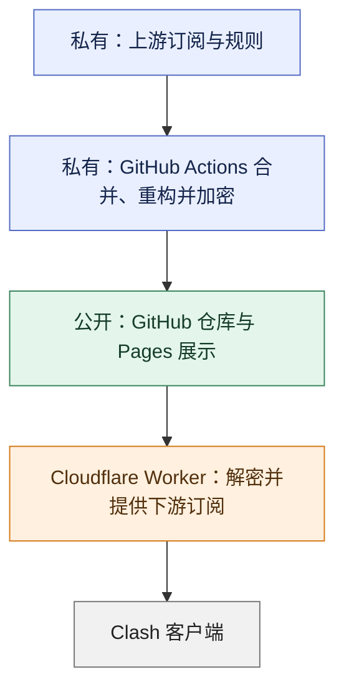

# Clash 订阅管理（公开展示）

[打开展示页](https://hyjack-00.github.io/clash_subscription_public/)

## 流程与名词

- **上游订阅**：供应商提供的一个或多个私密链接。
- **下游订阅**：Cloudflare Worker 解密后供 Clash 读取的合并配置；完整订阅地址包含下游密钥，必须保密。
- 蓝色代表私有仓库，绿色代表公开仓库，橙色代表 Cloudflare。

## 分组用法

在 Clash 中选择“通用组”，再选择 AI组、美国静态中转、美国组或香港组。AI组目前指向美国组；静态中转先经过美国组选出的节点，再连接静态代理。美国和香港组在客户端运行时每 5 分钟检测一次。

## 管理入口

- **更换上游订阅**：[私有仓库 Secrets](https://github.com/hyjack-00/clash_subscription_private/settings/secrets/actions) 中更新 `UPSTREAM_SUB_URLS`，每行一个链接；不要公开链接。
- **修改规则**：[编辑后台 Prompt](https://github.com/hyjack-00/clash_subscription_private/blob/main/config/agent_prompt.md)，提交后运行更新。Agent 逐个判断美国、香港或其他地区；通用组可选择 AI组、美国静态中转、美国组或香港组。
- **立即刷新**：[更新任务](https://github.com/hyjack-00/clash_subscription_private/actions/workflows/update-subscription.yml) → Run workflow → 选择 `main` → Run workflow；默认每 6 小时自动运行。
- **配置 Cloudflare**：[Cloudflare 控制台](https://dash.cloudflare.com/) · [Worker 部署说明](https://github.com/hyjack-00/clash_subscription_private/blob/main/worker/README.md)。

展示页公开上游显示名、脱敏节点名称与 Prompt；不要把订阅链接、密钥或节点凭据写进显示名称。
