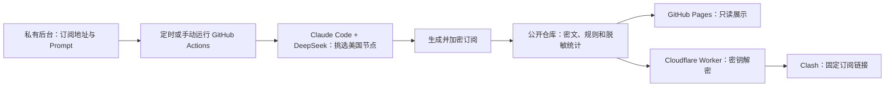

# Clash 订阅管理（公开展示）

[查看展示页](https://hyjack-00.github.io/clash_subscription_public/)（需要管理员先在 Pages 启用） · [查看分组 Prompt](prompt.md) · [后台管理与操作说明](https://github.com/hyjack-00/clash_subscription_private)（仅仓库授权用户）

## 管理入口

- **更换原始订阅**：[私有仓库 Secrets](https://github.com/hyjack-00/clash_subscription_private/settings/secrets/actions) 中更新 `SUBSCRIPTION_URL`；不要把订阅地址粘贴在公开网页或仓库。
- **修改规则**：[编辑后台 Prompt](https://github.com/hyjack-00/clash_subscription_private/blob/main/config/agent_prompt.md)，提交后运行一次更新。公开 Prompt 在更新成功时同步；目前 Agent 只识别美国节点。
- **立即刷新**：打开[更新任务](https://github.com/hyjack-00/clash_subscription_private/actions/workflows/update-subscription.yml)，点 Run workflow → 选择 `main` → Run workflow。无需手动执行时每 6 小时自动运行。
- **搭建订阅入口**：打开 [Cloudflare](https://dash.cloudflare.com/)，按[后台 Worker 指南](https://github.com/hyjack-00/clash_subscription_private/blob/main/worker/README.md)操作。

本仓库只存加密产物和公开信息，不要提交原始订阅、节点密码或密钥。状态统计在首次更新成功后生成。目前仍需完成有效的 Secrets 配置和 Cloudflare 部署。
